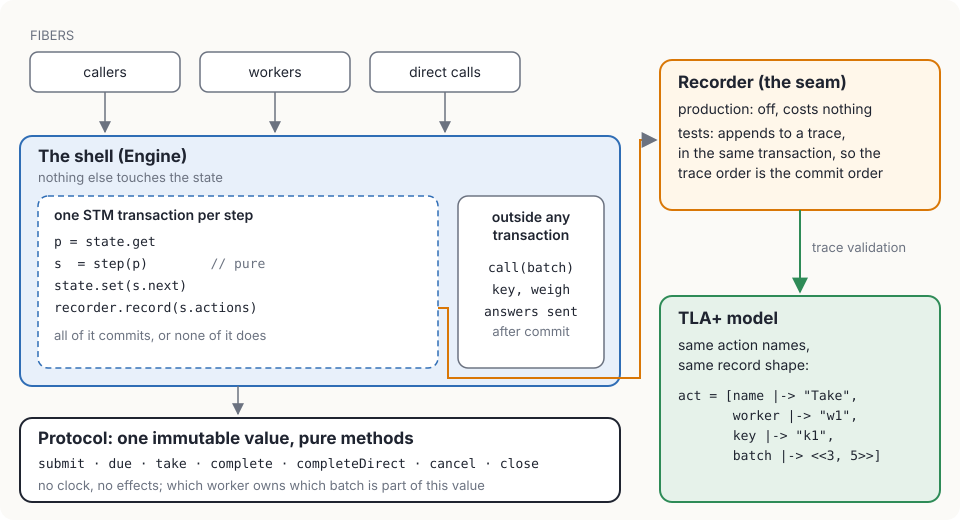
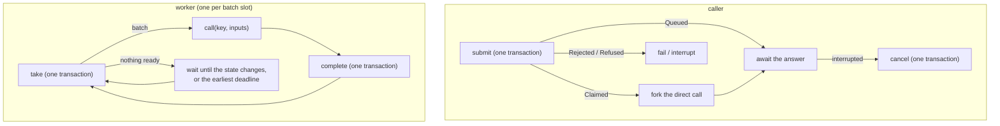

# The engine: one transaction per step

`Engine` is the ZIO shell around [the protocol](protocol.md), shared by every constructor. It follows one rule:

> Every change to the protocol's state is **one STM transaction that applies one protocol step and records the step's
> actions**. Nothing else touches the state.

The application's functions (`call`, `key`, `weigh`, `rank`, `extract`) run outside transactions, because a
transaction may retry.

## Fibers

- **Callers** submit, then wait for their answer. A caller interrupted while waiting cancels. For a direct call, it
  also stops the call and waits until it is over, because the call belongs to that caller alone.
- **Workers** take a batch, call it, and complete it, forever. Only the waiting and the call itself are
  interruptible. Once a worker has taken a batch, it always completes it, if need be with the outcome `Interrupted`.
- **Direct calls** run a claimed key's one input, then complete it.

## Answers are delivered after the commit

A step's transaction decides *who* is answered and *with what*. The answers are then delivered right after the commit,
through ordinary `Promise`s, in the order the step lists them.

Answering from inside the transaction would wake every answered caller through STM's retry mechanism. ZIO wakes
those callers in an order derived from identity hashes, which differs from run to run, and a run would then not be
reproducible under the [deterministic simulator](../verification.md#deterministic-simulation). The atomicity that
matters is unchanged: the decision is atomic with the state change and the recording. Every path that commits a step
delivers its answers before it can be interrupted (workers and direct calls are uninterruptible there, and so are
finalizers and `onInterrupt`). See [0019](../decisions/0019-answers-after-commit.md).

## Recording

Every step hands its actions to a `Recorder` *inside its transaction*, so a recorded trace is in the order the steps
took effect: there are no sequence numbers or clocks, and nothing can be reordered. In production the recorder is
off and the transaction does nothing extra. Tests record into a `TRef`, and check the trace against the model.

## Shutdown

Closing the ferry's scope runs three finalizers, in this order:

1. **Close**: one transaction closes admission and empties every lane, and those callers are interrupted. From now on
   `take` finds nothing, so workers send nothing more.
2. **Workers** are interrupted. A worker in the middle of a call completes it with the outcome `Interrupted`.
3. **Direct calls** are interrupted, and complete in the same way.

Because admission closes first, an interrupted call is always an event after close, and the model guards it that way.

## Why one `TRef`

Admission must be atomic with the check that the ferry is open. Taking a batch must be atomic with owning it and
marking its key busy. Completing must be atomic with freeing the key. With all the state in one value, each of these
is a single transaction, so races that a lock, a semaphore and uninterruptible regions would otherwise have to guard cannot happen.

The cost is that every caller contends on one `TRef`. If a measurement ever shows that this limits throughput,
several ferries over shares of the keys spread the load without changing any guarantee
([Scaling beyond one ferry](../guide/configuration.md#scaling-beyond-one-ferry)).
