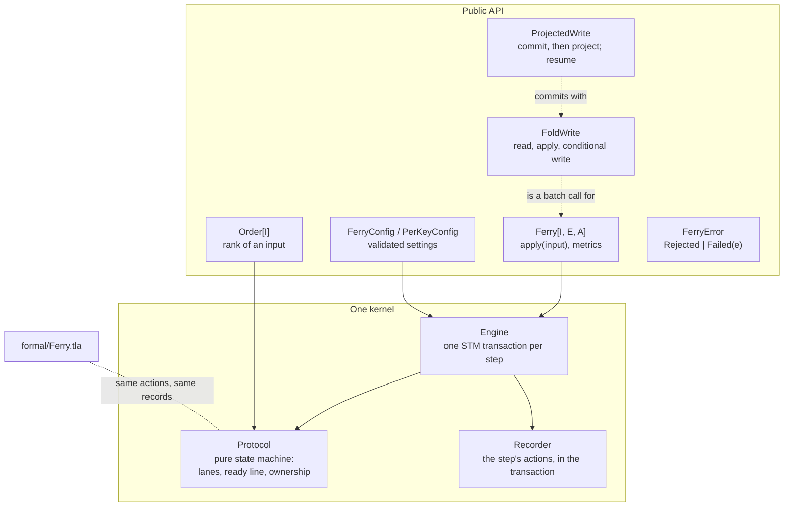

# Architecture

## Principles

The design follows from a few rules. Each is recorded, with its reasons, in the [decision records](../decisions/README.md).

- **A batcher is a bulkhead.** It decides how much load to let through, how much to hold, and what to turn away.
  Overload is answered at once, with `Rejected`, never with unbounded latency.
- **Never strand a caller.** Every input is owned by exactly one place at a time: its lane, a worker's batch, or its
  own direct call. That owner always answers it, including on interruption and shutdown. Ownership is part of the
  protocol's state, so this holds by construction.
- **One protocol, written once, checked against its model.** All shared state is one immutable value. Each step is one
  method, one STM transaction, and one action of the TLA+ model, with the same name. Recorded runs are checked against
  the model, and the model's behaviours are replayed through the code ([Verification](../verification.md)).
- **The store is the source of truth.** The library keeps no state between a key's batches and no log of its own.
  What decides correctness (order, deduplication, conflicts) lives in the write.
- **Application code runs outside transactions.** `key`, `weigh` and `rank` are evaluated once per input, before
  admission, because an STM transaction may retry.

## Components

| Source | Role |
|---|---|
| `Ferry.scala` | The public trait and the constructors: `make` and `keyed` are the one-key case, `perKey` the general one |
| `Protocol.scala` | The pure state machine: every scheduling decision, one method per model action |
| `Engine.scala` | The effectful shell: admission, workers, direct calls, cancellation, close |
| `Recorder.scala` | The seam between a step and its trace |
| `FerryConfig.scala`, `PerKeyConfig.scala` | Validated settings |
| `FerryError.scala` | The error type callers see |
| `Order.scala` | Pluggable dispatch order |
| `FoldWrite.scala` | The read, apply, conditional-write batch call |
| `ProjectedWrite.scala` | The same, followed by a fenced projection that can be resumed from the store |

## One kernel

| | `make` / `keyed` | `perKey` |
|---|---|---|
| Keys | one | `key(input)` |
| Batch contents | any inputs, in arrival order | one key's inputs, in rank order |
| In flight | up to `maxInFlightBatches` batches | up to `maxInFlightBatches` batches, at most one per key, plus direct calls for idle keys |
| When a batch leaves | full, or `maxBatchDelay` after its oldest input | the same; with zero delay, as soon as the key is free |
| Bounds | count | count and weight |

Both run the same [protocol](protocol.md) on the same [engine](engine.md), and both are checked against the same
model, [`formal/Ferry.tla`](https://github.com/EtaCassiopeia/zio-ferry/blob/main/formal/Ferry.tla). See
[0016](../decisions/0016-one-protocol.md).

## Beyond one process

`perKey` makes a process the only *local* writer of each key. Across a fleet, the write itself keeps things correct
when routing is imperfect. See [Running on a fleet](fleet.md).
