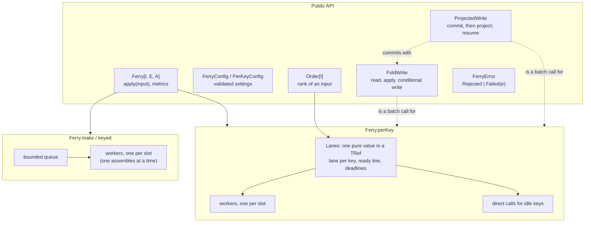

# Architecture

## Principles

The design follows from a few rules. Each is recorded, with its reasons, in the [decision records](../decisions/README.md).

- **A batcher is a bulkhead.** It decides how much load to let through, how much to hold, and what to turn away.
  Overload is answered at once, with `Rejected`, never with unbounded latency.
- **Never strand a caller.** Every input is owned by exactly one place at a time (the waiting room, a worker, or its
  own caller) and that owner always answers it, including on interruption and shutdown.
- **Keep the scheduling state pure.** `perKey`'s whole waiting room is one immutable value, changed by STM
  transactions. Each transition can be tested on its own and maps to one action of the formal model.
- **The store is the source of truth.** The library keeps no state between a key's batches and no log of its own.
  What decides correctness (order, deduplication, conflicts) lives in the write.
- **Application code runs outside transactions.** `key`, `weigh` and `rank` are evaluated once per input, before
  admission, because an STM transaction may retry.

## Components

| Source | Role |
|---|---|
| `Ferry.scala` | The public trait, the three constructors, and the implementation of `make` |
| `FerryConfig.scala`, `PerKeyConfig.scala` | Validated settings |
| `FerryError.scala` | The error type callers see |
| `PerKeyFerry.scala` | `perKey`'s effectful shell: admission, workers, direct calls, close |
| `Lanes.scala` | `perKey`'s pure waiting room: every scheduling decision |
| `Order.scala` | Pluggable dispatch order |
| `FoldWrite.scala` | The read, apply, conditional-write batch call |
| `ProjectedWrite.scala` | The same, followed by a fenced projection that can be resumed from the store; the projection answers which entries it left pending, so a view of one row per entry can land in part |

## Two kernels

`make` and `perKey` share the public trait and the error model, but not their internals. They make different
guarantees, so neither is a configuration of the other.

| | [`make` / `keyed`](single-queue.md) | [`perKey`](per-key.md) |
|---|---|---|
| Waiting room | one bounded queue | one lane per key, in one `TRef` |
| Batch contents | any inputs | one key's inputs, in rank order |
| In flight | up to `maxInFlightBatches` batches | up to `maxInFlightBatches` batches, at most one per key, plus direct calls for idle keys |
| When a batch leaves | full, or `maxBatchDelay` after its oldest input | full, or when the key's previous call completes (zero delay), or `maxBatchDelay` after its oldest input |
| Synchronisation | queue, lock and semaphore | STM transactions over one value |
| Bounds | count | count and weight |
| Formal model | `formal/Ferry.tla` | `formal/PerKey.tla` |

## Beyond one process

`perKey` makes a process the only *local* writer of each key. Across a fleet, the write itself keeps things correct
when routing is imperfect. See [Running on a fleet](fleet.md).
