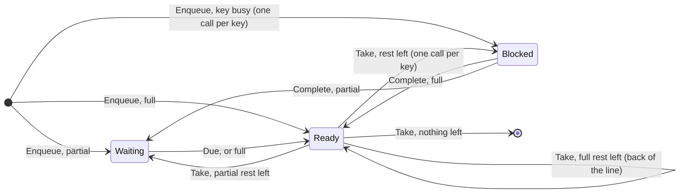

# The protocol: one pure state machine

Every Ferry, whether built by `make`, `keyed` or `perKey`, runs the same protocol. `Protocol` holds all of its shared
state in one immutable value and has one method per step. Each step is also an action of the formal model
[`formal/Ferry.tla`](https://github.com/EtaCassiopeia/zio-ferry/blob/main/formal/Ferry.tla), with the same name and
parameters. See [0016](../decisions/0016-one-protocol.md) and [0017](../decisions/0017-model-conformance.md).

## State

| Field | Holds |
|---|---|
| `open` | whether admission is open |
| `nextCaller` | the next caller's number: every submission gets one, in order |
| `pending` | callers let in and not yet answered |
| `lanes: Map[K, Lane]` | a lane per key that has inputs waiting |
| `ready: Queue[K]` | keys whose lanes can be taken, first come, first served |
| `waiting: TreeMap[Long, Vector[K]]` | keys whose lane holds a partial batch, by deadline |
| `busy: Map[K, Int]` | calls in flight per key, batched or direct |
| `batches: Map[Int, Batch]` | the batch each worker holds, until it completes |
| `direct: Map[Long, K]` | the key of each direct call in flight |
| `queued`, `weight` | inputs waiting, and their total weight, across all keys |

Ownership is part of the state. A worker's batch is in `batches` from the step that takes it to the step that
completes it, and a direct call is in `direct`. So "who must answer this caller" always has exactly one answer, by
construction.

## Limits

| Limit | `Ferry.make` | `Ferry.perKey` |
|---|---|---|
| keys | one | `key(input)` |
| `oneCallPerKey` | no: up to `maxInFlightBatches` batches of the one lane run at once | yes: a key with a call in flight is blocked |
| `direct` | no | `directIdleKeys` with a zero `maxBatchDelay` |
| rank | arrival | `Order` |
| weight | 1 | `weigh(input)` |

`Ferry.make` is the one-key case of the protocol, with nothing else special about it.

## A lane's states

A lane exists only while it holds inputs. It keeps them in ascending rank, ties in arrival order.

## Steps

| Step | Enabled when | Does |
|---|---|---|
| `submit` → `Refuse` | admission is closed | numbers the caller and turns it away |
| `submit` → `Claim` | `direct`, and the key is idle (no lane, nothing in flight) | the caller sends its input itself; the key becomes busy |
| `submit` → `Enqueue` | the waiting room has room by count and weight | the input joins its lane in rank order |
| `submit` → `Reject` | otherwise | the caller gets `Rejected` |
| `due` | a lane is waiting | it joins the back of the ready line. `take(now)` applies it to every lane due by `now`, earliest deadline first |
| `take` | admission is open, and a lane is ready | the first ready lane gives its longest prefix within `maxBatchSize` and `maxBatchWeight` (at least one input), and its key becomes busy |
| `complete` | the worker holds a batch | answers the batch's callers that are still pending, and frees the key; a lane blocked behind it goes back in line |
| `completeDirect` | the caller has a direct call in flight | the same, for a direct call |
| `cancel` | the caller is pending | answers it "interrupted"; if its input is still waiting, it leaves the lane at once |
| `close` | admission is open | closes admission and empties every lane; their callers are to be interrupted |

Every step returns three things: what the shell must act on (a batch to send, callers to answer), the next state, and
the `Action`s it took. Those actions are the records the model keeps in `act`.

## Why it is pure

- **Each step can be tested on its own** ([`ProtocolSpec`](https://github.com/EtaCassiopeia/zio-ferry/blob/main/core/src/test/scala/ferry/ProtocolSpec.scala)).
- **The model's behaviours can be replayed through it** without any concurrency: TLC generates a behaviour, and each
  step's `act` is applied to the code's protocol, with the states compared after every step.
- **The shell cannot interleave anything between the parts of a step**: it applies a whole step in one transaction.
