# Commit, then project, with `ProjectedWrite`

Some stores write a key's batch in two steps:

1. **Commit.** Append the new entries to the key's record, only if the record is still the one that was read. After
   this write the entries are durable.
2. **Project.** Bring the record's read-side view up to date: the state queries read, denormalised rows, final
   answers. This write is fenced too, so two writers can never project the same entries twice.

Between the two, the record says that its projection is **pending**: a marker the commit leaves and the projection
clears, such as "how much of the log is projected" or a flag. If the process fails or dies between the writes, the
record stays committed and pending, and any process can finish it later. `ProjectedWrite` packages this round trip,
the way [`FoldWrite`](fold-write.md) packages the one-write version.

The view may be one object per record, written in one write, or [one row per entry](#one-row-per-entry), each row its
own write. In the second case a projection can land for some entries of a batch and not others, and each input is
answered on its own.

## The round trip



`ProjectedWrite(fold, pending, project)`, or `ProjectedWrite.wholeRecord(fold, pending, project)` for a view of one
object per record:

| Parameter | What it does |
|---|---|
| `fold: FoldWrite[R, E, K, I, Id, S, O]` | The commit phase, exactly as for a one-write store: `read` the record, including its fence and its marker; `step` each input; `write` is the commit, fenced on the record read; `retry` applies to the commit and to the re-read projection. The commit must never move the stored marker backwards: leave it as stored, or fence the commit on the whole record read, marker included. |
| `pending: S => Boolean` | Whether a record, as read or as committed, has a projection to write. `step` returns the record as the commit stores it, so `pending` holds after a commit exactly when there is something to project. |
| `project: (K, S) => ZIO[R, E, Projection[Id, E]]` | Writes the view of the record and clears its marker, and answers what it left pending: for each entry whose row is not in the view, why. For a view of one row per entry, see [below](#one-row-per-entry). With `wholeRecord`, `project` is `(K, S) => ZIO[R, E, Any]`: it writes the whole view and clears the marker, only if the store still holds that record, and fails otherwise; it never leaves anything pending. |

```scala
--8<-- "ProjectedWrites.scala:projected"
```

`write.call` is the batch call and `write.outcome` the extract, as with `FoldWrite`:
`Ferry.perKey(config, (_: Entry).entity)(write.call)(write.outcome)`.

A call reads the record, folds the batch into it, and commits, retrying the commit as `FoldWrite` does. It then
projects the record it just committed, without reading it again. If that fails, it reads the record and projects it if
it is still pending, retried with the same schedule. A projection that answers with entries pending has not failed: the
call answers from it at once.

## What a caller gets

Each caller gets a `ProjectedWrite.Outcome[E, O]`, where `O` is the outcome `step` gave its input:

| Outcome | Meaning | Tell the client |
|---|---|---|
| `Projected(result)` | Committed, and the view is known to include it. | Done. |
| `Committed(provisional, cause)` | Committed, but its projection was not confirmed: its own row failed, or the record's projection kept failing. `cause` is that error. The view may already include it. | Accepted, and why the view is late. A sweeper you run, or the key's next batch, finishes the view. Do not resubmit to hurry it. |
| `FerryError.Failed(e)` | The commit is not known to have happened. | Retry, as with any [fenced write](fold-write.md): if it did happen, `step` answers the input without applying it again. |

Each input is answered on its own. It is `Projected` if the projection's answer does not list it as pending: its row
landed, was already there, or a re-read found nothing pending. It is `Committed` with its own cause if the answer lists
it, and every input of the call is `Committed` with the same cause when the projection failed and `resume` failed too,
after its retries. For a view of one object per record nothing is ever listed, so all inputs of a call get the same
status. An input rejected on its merits is an `O`, such as a `Left`, under either status.

```scala
--8<-- "ProjectedWrites.scala:answer"
```

The call fails only when the commit is not known to have happened. A failed projection is reported, not failed,
because the inputs are durable: failing their callers would make them retry something that already happened
([0006](../decisions/0006-per-input-outcomes.md)).

## Finishing what was interrupted

`write.resume(key)` is the projection on its own: it reads the record and projects it if it is pending, retried with
`fold.retry`. It does nothing when nothing is pending. It answers what is still pending, `Projection.complete` when
nothing is; add `.unit` where a `Unit` is needed. A sweeper calls it for every pending record. Finding those is a query
on the store's side, such as an index on the marker:

```scala
--8<-- "ProjectedWrites.scala:sweeper"
```

A sweeper for a view of one row per entry can log what each run left, and why:

```scala
--8<-- "ProjectedRows.scala:sweeper"
```

`resume` is safe to run anywhere, at any time, without going through the ferry: concurrently with the key's batches,
on another process, in several sweepers at once. For a view of one object per record, the projection's fence lets at
most one projection of a record land, and the others re-read and find nothing pending. For a view of one row per entry,
several projections' row writes may land at once, each row once because row writes are idempotent; only the clear is
fenced, and a projection that finds rows still missing answers what is pending rather than re-reading.

The next batch of a pending key finishes the projection too: its commit leaves the record pending, and its projection
covers everything unprojected. So does a client's retry after a crash, which finds its input committed and the record
pending.

## The projection's fence covers the whole record

`project(key, state)` must succeed only if the store still holds `state`: its fence **and** its marker.

- The **marker** refuses a second projection of the same entries. Without it, a sweeper and a writer that both read
  the record pending would both append its entries to the view.
- The **fence** keeps a projection of a stale record from clearing the marker of a later commit. With a boolean flag
  as the marker, a projection made from version 3 must not clear the flag that the commit of version 4 set, or
  version 4 is never projected. With a watermark as the marker, this part is redundant but harmless.

The [ProjectedWrites example](https://github.com/EtaCassiopeia/zio-ferry/blob/main/examples/src/main/scala/ferry/examples/ProjectedWrites.scala)
runs this against a store whose view goes down for a while. The entries written meanwhile come back `Committed`, the
sweeper finishes them, and every view ends equal to its log, each entry once.

## One row per entry

Some views are one row per entry: a ledger whose read side is one row per committed entry, each row its own
conditional write. There, one throttled row out of many leaves the record **partially projected**: most of the batch is
in the view, one entry is not. `project` then answers with what it left pending, a `Projection[Id, E]`: for each entry
whose row is not in the view, why. `Projection.complete`, the empty answer, means every row is in and the marker is
cleared.



```scala
--8<-- "ProjectedRows.scala:rows"
```

```scala
--8<-- "ProjectedRows.scala:projected"
```

The store keeps three rules:

- **Row writes are idempotent.** A row already in the view is present: not written again, and not a cause. A row is a
  function of its committed entry alone, so a row written by a projection of an older record is the same row a newer
  one would write, and a writer and a sweeper projecting one record at once write each row once.
- **The marker clears only when every row is present.** A partially projected record stays pending, and `resume`
  writes exactly the rows that are missing.
- **The clear is fenced on the record**, version and marker, like a whole-record projection. A clear made for an older
  record must not clear the marker a later commit set, or that commit's entries are never projected.

`project` works from the record alone: `resume` has no inputs, so the record must yield each entry's id and row. The
`Id`s are the ones `fold.id` gives the inputs, which the record already holds so that `step` can answer a replay.

A projection with entries pending is a verdict, final for the call: the library does not retry it, because
`fold.retry` is driven by one error and a partial answer has no single honest one. The store owns its per-row retries
and chooses: fail the effect to have the round trip re-read and retried, or answer what is pending and leave it to the
sweeper. Either way the answer is truthful, and the sweeper finishes.

```scala
--8<-- "ProjectedRows.scala:answer"
```

The [ProjectedRows example](https://github.com/EtaCassiopeia/zio-ferry/blob/main/examples/src/main/scala/ferry/examples/ProjectedRows.scala)
runs this against a store that throttles one row write in nine and whose row writes go down for a while. The entries
whose rows failed come back `Committed`, each with its cause, the rest of their batches `Projected`; the sweeper
finishes the missing rows, and every view ends with one row per entry of its log, each once. See
[0015](../decisions/0015-per-entry-projection.md).

## Why the marker is in the store

`ProjectedWrite` keeps nothing between calls. The marker is part of the record that `read` returns, so the store stays
the only source of truth, and recovery is still "read again and continue" ([0005](../decisions/0005-fenced-single-writer.md)):
the process that finishes a projection need not be the one that started it. See
[0014](../decisions/0014-commit-then-project.md).

## Replay

A client that resubmits an input after a lost response goes through the lane like any input. `step` finds it in the
record and answers it without applying it again; if its projection is still pending, the call finishes it. Answering
replays before they reach the ferry, from a cache of recent answers, is an optimisation an application can add in front
of it. Correctness never needs it.

## Verified

- `ProjectedWriteSpec`: conflicts, lost responses, refused and raced projections, replays, exhausted retries, stale
  projections and concurrent `resume` calls; and for one row per entry, throttled and lost rows, rows a sweeper wrote
  first, partially projected replays, a refused stale clear, mixed outcomes through `Ferry.perKey`, and the three rules
  each switched off.
- `ProjectedWriterSimulation`: several processes, a sweeper, throttling, lost and late writes, misrouted clients and
  a crash between the two writes. Without the projection's fence an entry is projected twice; without a sweeper a
  projection that ran out of retries is never finished; answering `Projected` straight after the commit claims a view
  that is not there.
- `PartialProjectionSimulation`: the same, for one row per entry, with throttled, lost and late rows, refused clears
  and a crash between two row writes. Rows written unconditionally land twice; a clear that does not wait for every row,
  or is not fenced, clears the marker with a row missing; without a sweeper a throttled row is never written.
- `formal/ProjectedWriter.tla`: every interleaving of a small instance. Its variants without the fence, without resume,
  and answering before the projection landed must each fail. `formal/ProjectedWriterPartial.tla` does the same for one
  row per entry, with variants for unconditional rows, an early clear, an unfenced clear and no resume. See
  [Verification](../verification.md).
