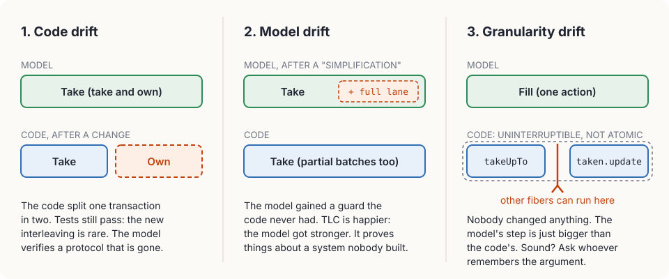
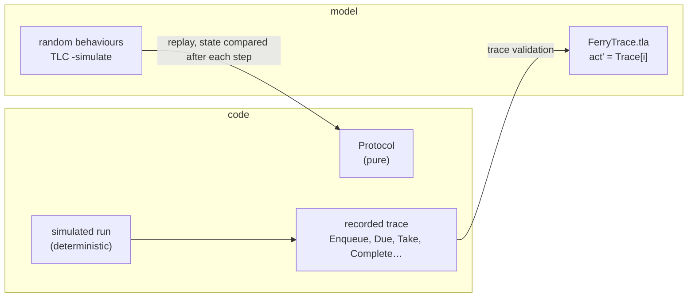

# Verification

A batcher's bugs are concurrency bugs: a caller left waiting forever, an input sent twice, a key with two calls in
flight, a batch out of order. Example-based tests cover only the interleavings someone thought of, and a TLA+ model
covers every interleaving of a protocol that may not be the one the code runs. Ferry is checked in layers. The layers
are tied together so that **the model and the code cannot drift apart without a test failing**. See
[0002](decisions/0002-layered-verification.md), [0017](decisions/0017-model-conformance.md) and
[0018](decisions/0018-deterministic-simulation.md).

## How a model drifts from its code

A model checked once, next to code that keeps changing, drifts from it in three ways, and nothing fails when it does:



- **The code moves.** A refactoring splits one transaction in two. The tests still pass, because the new interleaving
  is rare, and the model still passes, because it checks a protocol that no longer exists.
- **The model moves.** Someone simplifies the model and adds a guard the code never had. TLC is happier, because the
  model got stronger, but it now proves things about a system nobody built.
- **Neither moves, but the steps differ in size.** The model takes in one action what the code does in two, with a gap
  between them that other fibers can run in. Whether that is safe is an argument in somebody's head.

A check in one direction cannot see all three. Checking the code's runs against the model catches the code doing
something the model forbids, but not the model allowing something the code never does. Driving the code through the
model's behaviours catches the converse. So Ferry checks both, and makes the steps the same size by construction.

## The layers

| Layer | What it gives | Where |
|---|---|---|
| Unit tests on virtual time | exact timing of deadlines and delays | `FerrySpec`, `PerKeySpec`, `FoldWriteSpec`, `ProjectedWriteSpec` |
| Property tests | `keyed` sends each distinct input once; a configuration is accepted exactly when its constraints hold | `FerryPropertySpec` |
| Protocol tests | each step of the pure state machine, on its own | `ProtocolSpec` |
| Model-based tests | batches and dispatch instants agree with an independent executable model | `FerryModelSpec` |
| Deterministic simulation | random scenarios in which scheduling, time and outcomes are recorded decisions; every run checked against the contract, replayable and shrinkable; runs of up to 6 callers for the model, up to 24 for the contract alone | `FerrySimulation`, `SimulationConformanceSpec` |
| Trace validation (code → model) | every simulated run is a behaviour of the TLA+ model | `SimulationConformanceSpec`, `TraceValidationSpec` |
| Model replay (model → code) | every behaviour TLC generates is followed step by step by the code | `ModelReplaySpec` |
| Vocabulary and coverage | the code's actions are the model's, and all of them are exercised on both sides | `VocabularySpec` |
| Planted drift | wrong code and wrong models are caught | `DriftSpec` |
| Writer simulations | fenced writes and projections through crashes, lost answers and throttling; every run is a behaviour of its writer's model, key by key, and each safeguard is rejected by the model with it. They run on ZIO's `TestClock`, seeded: a failure is reproduced by its seed, not replayed from decisions | `PerKeyPropertySpec`, `ProjectedWriterSimulationSpec`, `PartialProjectionSimulationSpec`, and a `…ConformanceSpec` for each |
| The simulator itself | the same decisions give the same run; a run replays from its decisions alone; a program that can never finish is reported as hung | `SimulatorSpec`, `ExploreSpec` (in `testkit`) |
| Stress tests on the real scheduler | interleavings a single-threaded simulator never runs | `FerryStressSpec`, `PerKeyStressSpec` |
| TLA+ model checking | every interleaving of the protocol in a small instance, for safety and liveness | [`formal/`](https://github.com/EtaCassiopeia/zio-ferry/tree/main/formal) |

## The code and the model, kept in step

Three rules make the check mechanical.

1. **Every step of the code is an action of the model.** All of Ferry's shared state is one pure value,
   [`Protocol`](architecture/protocol.md), with one method per step. The [engine](architecture/engine.md) applies
   each step in one STM transaction, and inside it hands the step's actions to a recorder. A recorded trace is
   therefore in the order the steps took effect.
2. **Both sides write the same record.** The model keeps a history variable `act`. Every action sets it to a record
   such as `[name |-> "Take", worker |-> "w1", key |-> "k1", batch |-> <<3, 5>>]`, which is exactly what the code
   records for the same step.
3. **The model's free choices are only the environment's.** Arrivals, a deadline passing (`Due`), a call's outcome, a
   caller giving up, and close. Which lane a worker takes, and how much of it, the model decides as the code does.

With those rules, there are two checks, one in each direction:



- **Code → model.** A recorded run is written as a TLA+ module. TLC explores
  [`FerryTrace.tla`](https://github.com/EtaCassiopeia/zio-ferry/blob/main/formal/FerryTrace.tla), which takes one
  model step per recorded event and requires the model's `act` to equal the event. The run is *accepted* if the end
  of the trace is reachable, and otherwise *rejected* with the number of events that matched. This is trace
  validation, after Cirstea, Kuppe, Loillier and Merz (SEFM 2024).
- **Model → code.** TLC generates random behaviours of each configuration of the model. Each step's `act` is applied
  to the code's `Protocol`, which must take the very same action. Its state (lanes, schedules, ready line, busy keys,
  batches, pending callers) must then equal the model's.

A missing TLC makes these suites fail with "skipped", never pass. They look for `tla2tools.jar` in `$TLA2TOOLS`, at
the root of the repository, or in the usual local installs.

### Planted drift

`DriftSpec` makes the code and the model disagree on purpose, and requires the checks to notice:

| Drift | Caught by |
|---|---|
| the engine serves the *last* ready lane first | trace validation, and replay |
| the engine ignores `maxBatchWeight` | trace validation, and the contract |
| the engine leaves a cancelled input in its lane | trace validation, and replay |
| the model takes only full lanes | trace validation of the code's partial batches |
| the model lets a cancelled caller keep its place | trace validation, and replay |
| the engine sends partial batches before their deadline | the contract only: TLC accepts every run |

Two of the three code drifts the model catches break no check of the simulation's contract. Each is a change of
behaviour that a test written for the contract would not see, which is why it matters to have the model as an oracle.

The last row is the converse. The model has no clock: a deadline passing is an environment action (`Due`) it may take
at any time. So the timing of batches, like the user's call and what each caller is answered from it, is checked by
the contract alone. The two oracles divide the work:

| The contract checks | The model checks |
|---|---|
| no partial batch leaves before its deadline (virtual time) | per-key order, from the order of admission |
| each caller is answered from the call that carried its input, with that call's outcome | a caller who gave up is never sent |
| batch size and weight, keys not mixed, direct calls carry only their caller's input | nothing is taken after close |
| at most one call per key, and no more worker calls than workers | a refused or rejected input is never sent, and every caller is answered |

`DriftSpec` asserts which side catches each drift, so this table is tested too.

## Deterministic simulation

The simulator (in the `testkit` module) runs a ZIO program with every source of nondeterminism turned into a recorded
decision:

- **Scheduling.** All fibers run on one executor, driven from the test's thread. When more than one could run,
  which one does is a decision.
- **Time.** The clock is virtual and jumps to the next sleep. A sleep that is due competes with the runnable fibers,
  so "the timeout fires first" and "the answer arrives first" are both explored.
- **Program-owned choices**, such as a simulated call's latency and outcome, are decisions too.

A run is therefore a function of its scenario and its decisions. The same seed gives the same run, and
`Decisions.scripted(run.script)` replays it exactly. A failing run is reported with its seed and a script shrunk to
the shortest that still fails.

### Seeing the branches of a run

Changing one decision and replaying the rest gives a *branch*. `Visualize` explores one scenario's branches and writes
two kinds of output:

- **A self-contained page**: the tree of branches, each branch's timeline (callers, workers, keys, and the decisions,
  imposed or free), what changed from its parent, and whether it keeps the contract and is accepted by TLC.
- **Chrome trace events**, which open in [Perfetto](https://ui.perfetto.dev).

```sh
sbt "core/Test/runMain ferry.viz.Visualize PerKeyBatched 7 target/viz"
sbt "core/Test/runMain ferry.viz.Visualize Make 12 target/viz-drift KeepCancelledInLane"   # with drifted rules
```

A branch can also be *steered*. Search for a run with a given property, such as "a call fails, then its key is served
again", then shrink it to the fewest decisions that still produce it. Replaying those decisions pins that
interleaving: what a fault-injection probe does by pausing a fiber at a point, but with nothing paused and nothing
timing-dependent.

## Formal models

`Ferry.tla` models the protocol behind both constructors, action for action. Every model ships with **weakened
variants that must fail**: each removes one mechanism, and TLC finding a counterexample shows both that the mechanism
is needed and that the model can notice its absence.

| Model | Checks | Variants that must fail |
|---|---|---|
| `Ferry.tla` (`Ferry`, `FerryBatchOnly`, `FerryMake`) | one call in flight per key; rank order; no input sent twice; turned-away inputs never sent; batches and the waiting room bounded by count and weight; no caller stranded after close; every caller answered | `FerryUnsorted`: out of rank order. `FerryNoBusyGuard`, `FerryNoDirectGuard`: two calls in flight for one key. `FerryNonAtomicAdmission`, `FerryNoDrain`: a caller stranded after close |
| `FencedWriter.tla` | across processes with arbitrary routing, crashes, lost answers and throttling: no input applied twice, every answer true | `FencedWriterUnfenced`, `FencedWriterNoDedup`: an input is applied twice |
| `ProjectedWriter.tla` | the same for a commit followed by a fenced projection and a sweeper | `ProjectedWriterUnfencedProject`, `ProjectedWriterEarlyAnswer`, `ProjectedWriterNoResume` |
| `ProjectedWriterPartial.tla` | the same, for a view of one row per entry | `ProjectedWriterPartialUnconditionalRows`, `ProjectedWriterPartialEarlyClear`, `ProjectedWriterPartialUnfencedClear`, `ProjectedWriterPartialNoResume` |

Each model checked against runs of the code has a trace module next to it, which takes one model step per recorded
event: `FerryTrace.tla`, `FencedWriterTrace.tla`, `ProjectedWriterTrace.tla` and `ProjectedWriterPartialTrace.tla`.
The `act` record changes on every step, so the writer configurations that check safety compare states through a
`VIEW` that leaves it out, which keeps the state space from growing with it. The per-entry model's liveness is checked
in a configuration of its own, `ProjectedWriterPartialLiveness`, without the `VIEW`.

CI runs every configuration on every change, and fails if a passing model fails or a weakened variant passes.

## Exploring at random, on purpose

A run that found something new could be revisited and varied, as a fuzzer varies inputs. That was measured before
being adopted ([0021](decisions/0021-explore-at-random.md)). Guidance by forking or mutating kept runs found 82 to
97 per cent of the protocol-state shapes that fresh random runs found on the same budget, so the simulation draws every
run from a fresh seed. `sbt "core/Test/runMain ferry.explore.Coverage 200 10 24"` repeats the measurement.

## Running it

```sh
sbt testFull                                  # every test, conformance included (needs tla2tools.jar)
FERRY_SAMPLES=500 sbt testFull                # search longer, e.g. before a release
formal/check.sh path/to/tla2tools.jar         # TLC, every model and variant
```

## Limits

- **Bounded evidence.** Trace validation covers the runs that were simulated. Replay covers the behaviours TLC
  generated. Model checking covers every behaviour of small instances of the model.
- **No proof for larger instances.** An inductive invariant checked by Apalache would prove safety for any number of
  callers and keys, but it stays deferred ([0008](decisions/0008-deferred.md)). It would strengthen what is known about
  the models, not whether the code matches them, which is what this page is about. Finding an invariant that every step
  preserves is the bulk of that work, and every bug found so far showed at TLC's small bounds. Revisit if the models
  outgrow what TLC checks in CI, or if a result for any number of callers is wanted.
- **The writer models are checked against simulations, not deployments.** Their recorded runs come from the
  simulations' fake stores ([0020](decisions/0020-writer-conformance.md),
  [0022](decisions/0022-projection-conformance.md)). A real store is trusted to behave like its fake: to apply a
  conditional write atomically, and to refuse it exactly when the fence says so.
- **Atomicity is assumed, not checked.** Every check here trusts that each recorded step was one transaction. A step
  split in two shows only when some run happens to put another step in the gap. The simulator explores many orderings,
  so such a gap is likely to be hit; likely is not certain.
- **A record is a claim.** Trace validation compares the recorded actions with the model's, not the states. If a
  step's record leaves out a decision the step made, such as whether a conditional write was refused, the model may
  take the other branch and accept the run. So every record says what its step did, not only that it ran.
- **Checks of runs see only the paths runs take.** A drift that needs, say, two lanes ready at once is invisible in a
  run that never has two lanes ready together. Model checking covers those states; trace validation and replay only
  judge the paths that were run.
- **The simulator is single-threaded.** The stress tests remain the check against real-thread surprises.
- **Nothing here measures performance.** Benchmarks come before any performance work ([0008](decisions/0008-deferred.md)).
