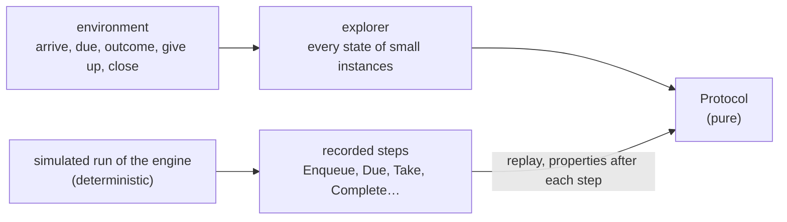

# Verification

A batcher's bugs are concurrency bugs: a caller left waiting forever, an input sent twice, a key with two calls in
flight, a batch out of order. Example-based tests cover only the interleavings someone thought of. Ferry's protocol is
a pure state machine whose only choices are its environment's, so it is **checked directly**: every state of small
instances is explored, and every simulated run of the real, concurrent engine is replayed through it. There is one
description of the protocol, the code, so there is nothing for it to drift from. See
[0002](decisions/0002-layered-verification.md), [0018](decisions/0018-deterministic-simulation.md) and
[0023](decisions/0023-the-code-is-the-model.md).

| Layer | What it gives | Where |
|---|---|---|
| Unit tests on virtual time | exact timing of deadlines and delays | `FerrySpec`, `PerKeySpec`, `FoldWriteSpec`, `ProjectedWriteSpec` |
| Protocol tests | each step of the pure state machine, on its own | `ProtocolSpec` |
| Model-based tests | batches and dispatch instants agree with an independent executable model | `FerryModelSpec` |
| State-space exploration | every state of small instances of the protocol: safety properties in each, liveness once the environment stops, and weakened variants that must fail | `check/ProtocolSpace`, `ProtocolSpaceSpec` |
| Deterministic simulation | random scenarios in which scheduling, time and outcomes are recorded decisions; every run checked against the contract, replayable and shrinkable; up to 24 callers | `FerrySimulation`, `SimulationConformanceSpec` |
| Replay of recorded runs | every simulated run of the engine, step by step through the protocol, with every property checked after each step | `SimulationConformanceSpec` |
| Coverage | every step of the protocol is taken by some simulated run | `VocabularySpec` |
| Planted drift | wrong rules in the engine are caught, and the table of which check catches what is tested | `DriftSpec` |
| Writer simulations | fenced writes and projections through crashes, lost answers and throttling; every run is a behaviour of its writer's TLA+ model, key by key, and each safeguard is rejected by the model with it | `FencedWriterSimulation`, `ProjectedWriterSimulation`, `PartialProjectionSimulation`, and a `…ConformanceSpec` for each |
| Stress tests on the real scheduler | interleavings a single-threaded simulator never runs | `FerryStressSpec`, `PerKeyStressSpec` |
| TLA+ model checking | the fleet patterns: every interleaving of small instances, for safety and liveness | [`formal/`](https://github.com/EtaCassiopeia/zio-ferry/tree/main/formal) |

## The protocol, checked directly

Two design rules make the code checkable as it stands.

1. **All shared state is one pure value, changed one named step at a time.** [`Protocol`](architecture/protocol.md)
   holds every lane, every pending caller and every batch in flight, with one method per step. The
   [engine](architecture/engine.md) applies each step in one STM transaction and records the step's actions inside it,
   so a recorded run is the protocol's steps in the order they took effect.
2. **The protocol's only free choices are its environment's.** Arrivals, a deadline passing (`due`), a call's outcome,
   a caller giving up, and close. Which lane a worker takes, and how much of it, the protocol decides deterministically.

With those rules, two checks use the same steps and the same properties:



- **Exploration.** From the empty protocol, the explorer applies every action the environment may take, breadth
  first, so a counterexample is a shortest path. It checks the safety properties in every state, and liveness where
  only the environment could still act: everyone let in has been answered. The graph must have no cycle, which makes
  that liveness check sound.
- **Replay.** Each run of the real engine under the simulator is replayed step by step through the pure protocol. Each
  recorded step must be exactly what the protocol does from the state the run reached, and every property must hold
  after it.

The properties are stated over what an observer sees (who was let in, in what order per key, what was sent, who was
answered), not over the protocol's internals:

| Property | Meaning |
|---|---|
| `OneInFlightPerKey` | `perKey`: a key never has two calls in flight, batched or direct |
| `InOrderPerKey` | a key's inputs are sent in rank order, ties in admission order |
| `AtMostOnce` | no input is sent twice |
| `TurnedAwayNeverSent` | a rejected or refused input is never sent |
| `BatchBounded`, `QueueBounded` | batches and the waiting room stay within their count and weight limits |
| `NoneStrandedAfterClose` | after close, every caller still waiting is in a call that will answer it |
| `CancelledNeverSent` | an input whose caller gave up while it waited is never sent |
| `FirstComeFirstServed` | ready lanes are served in the order they became ready |
| liveness | once the environment stops, everyone let in is answered |

Each passing configuration has **weakened variants that must fail**: the same protocol with one safeguard removed in
code (rank order, blocking a busy key's lane, claiming only an idle key, emptying the lanes on close). The explorer
must find a counterexample for each, which shows both that the safeguard is needed and that the properties notice its
absence.

### Planted drift

`DriftSpec` runs the engine on deliberately wrong rules and records which check notices:

| Drift | The properties (exploration and replay) | The contract |
|---|---|---|
| the engine serves the *last* ready lane first | caught: `FirstComeFirstServed` | passes |
| the engine ignores `maxBatchWeight` | caught: `BatchBounded` | caught |
| the engine leaves a cancelled input in its lane | caught: `CancelledNeverSent` | passes |
| the engine sends partial batches before their deadline | passes: the protocol has no clock | caught |

Two of the three drifts the properties catch break no check of the simulation's contract: each is a change of
behaviour that a test written for the contract would not see. The last row is the converse. The protocol has no clock:
a deadline passing is an environment action (`due`) that may happen at any time. So the timing of batches, like the
user's call and what each caller is answered from it, is checked by the contract alone. The two divide the work:

| The contract checks | The properties check |
|---|---|
| no partial batch leaves before its deadline (virtual time) | per-key order, from the order of admission |
| each caller is answered from the call that carried its input, with that call's outcome | a caller who gave up is never sent |
| batch size and weight, keys not mixed, direct calls carry only their caller's input | nothing is taken after close |
| at most one call per key, and no more worker calls than workers | a refused or rejected input is never sent, and every caller is answered |

`DriftSpec` asserts which side catches each drift, so this table is tested too.

## Deterministic simulation

The simulator (in the `testkit` module) runs a ZIO program with every source of nondeterminism turned into a recorded
decision:

- **Scheduling.** All fibers run on one executor, driven from the test's thread. When more than one could run,
  which one does is a decision.
- **Time.** The clock is virtual and jumps to the next sleep. A sleep that is due competes with the runnable fibers,
  so "the timeout fires first" and "the answer arrives first" are both explored.
- **Program-owned choices**, such as a simulated call's latency and outcome, are decisions too.

A run is therefore a function of its scenario and its decisions. The same seed gives the same run, and
`Decisions.scripted(run.script)` replays it exactly. A failing run is reported with its seed and a script shrunk to
the shortest that still fails.

### Seeing the branches of a run

Changing one decision and replaying the rest gives a *branch*. `Visualize` explores one scenario's branches and writes
two kinds of output:

- **A self-contained page**: the tree of branches, each branch's timeline (callers, workers, keys, and the decisions,
  imposed or free), what changed from its parent, and whether it keeps the contract and replays through the protocol
  with every property holding.
- **Chrome trace events**, which open in [Perfetto](https://ui.perfetto.dev).

```sh
sbt "core/Test/runMain ferry.viz.Visualize PerKeyBatched 7 target/viz"
sbt "core/Test/runMain ferry.viz.Visualize Make 12 target/viz-drift KeepCancelledInLane"   # with drifted rules
```

A branch can also be *steered*. Search for a run with a given property, such as "a call fails, then its key is served
again", then shrink it to the fewest decisions that still produce it. Replaying those decisions pins that
interleaving: what a fault-injection probe does by pausing a fiber at a point, but with nothing paused and nothing
timing-dependent.

## Formal models of the fleet patterns

The protocol has no TLA+ model: it is checked directly. What runs on a fleet of nodes is not the library's code alone:
nodes, a shared store and a network that loses answers. Those patterns are modelled in TLA+, and each model ships with
**weakened variants that must fail**. Each simulated writer run is checked against its model by trace validation, key
by key ([0020](decisions/0020-writer-conformance.md), [0022](decisions/0022-projection-conformance.md)).

| Model | Checks | Variants that must fail |
|---|---|---|
| `FencedWriter.tla` | across processes with arbitrary routing, crashes, lost answers and throttling: no input applied twice, every answer true | `FencedWriterUnfenced`, `FencedWriterNoDedup`: an input is applied twice |
| `ProjectedWriter.tla` | the same for a commit followed by a fenced projection and a sweeper | `ProjectedWriterUnfencedProject`, `ProjectedWriterEarlyAnswer`, `ProjectedWriterNoResume` |
| `ProjectedWriterPartial.tla` | the same, for a view of one row per entry | `ProjectedWriterPartialUnconditionalRows`, `ProjectedWriterPartialEarlyClear`, `ProjectedWriterPartialUnfencedClear`, `ProjectedWriterPartialNoResume` |

CI runs every configuration on every change, and fails if a passing model fails or a weakened variant passes.

## Exploring at random, on purpose

A run that found something new could be revisited and varied, as a fuzzer varies inputs. That was measured before
being adopted ([0021](decisions/0021-explore-at-random.md)). Guidance by forking or mutating kept runs found 82 to
97 per cent of the protocol-state shapes that fresh random runs found on the same budget, so the simulation draws every
run from a fresh seed. `sbt "core/Test/runMain ferry.explore.Coverage 200 10 24"` repeats the measurement.

## Running it

```sh
sbt testFull                                  # every test (the writer suites need tla2tools.jar)
FERRY_SAMPLES=500 sbt testFull                # search longer, e.g. before a release
formal/check.sh path/to/tla2tools.jar         # TLC, every writer model and variant
```

## Performance

`ferry.bench.FerryBench` measures throughput and latency under contention, from one to 1024 concurrent callers. Each
ferry has one serial point, the STM transaction on its single `TRef`, so throughput per ferry levels off as callers
grow. Splitting a per-key ferry into independent ferries by key hash keeps per-key order and raises throughput under
heavy load, about three times with 8 shards on 10 cores ([0023](decisions/0023-the-code-is-the-model.md)).

## Limits

- **Bounded evidence.** Exploration covers every state of small instances. Replay covers the runs that were simulated.
  Neither is a proof for any number of callers.
- **Liveness is bounded.** "Once the environment stops, everyone let in is answered", on an acyclic state graph, is
  weaker than a temporal property under fairness in general. For this protocol, whose every step consumes something,
  the two coincide.
- **No abstract specification to read.** The properties in `ProtocolSpace` and the architecture pages describe the
  protocol for readers; there is no shorter model of it.
- **Fairness is observed from the protocol's own state.** `FirstComeFirstServed` reads which lanes are ready from the
  protocol: a drift in how lanes become ready would be trusted.
- **The writer models are checked against simulations, not deployments.** Their recorded runs come from the
  simulations' fake stores ([0020](decisions/0020-writer-conformance.md),
  [0022](decisions/0022-projection-conformance.md)). A real store is trusted to behave like its fake: to apply a
  conditional write atomically, and to refuse it exactly when the fence says so.
- **The simulator is single-threaded.** The stress tests remain the check against real-thread surprises.
- **Performance is measured, not checked.** Nothing fails when throughput or latency regresses.
